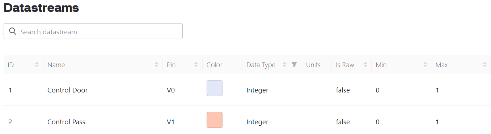
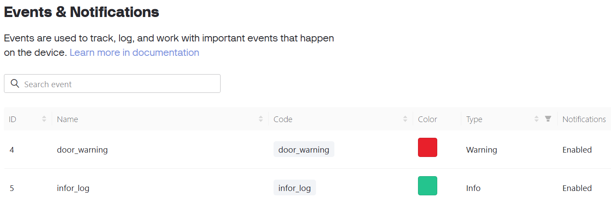
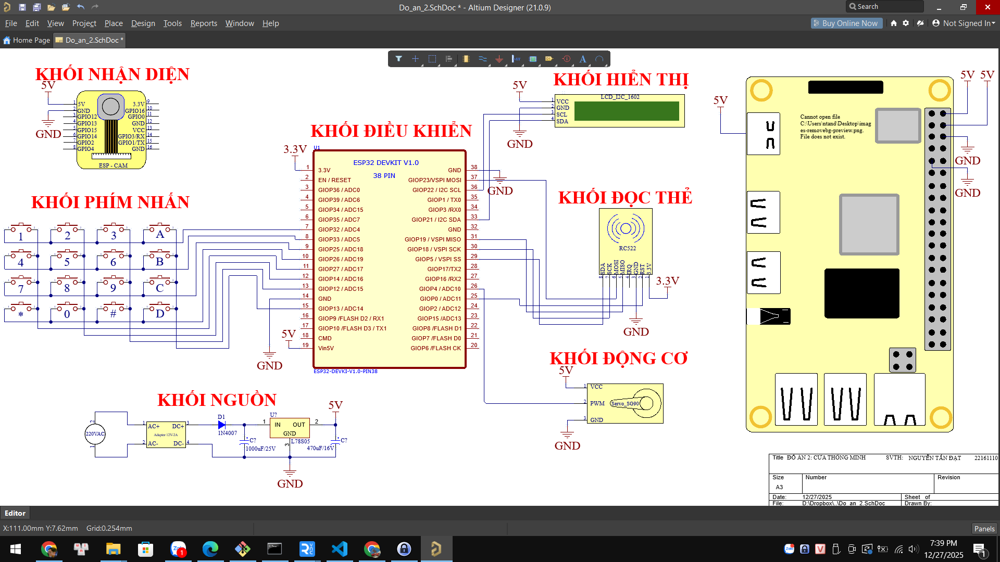
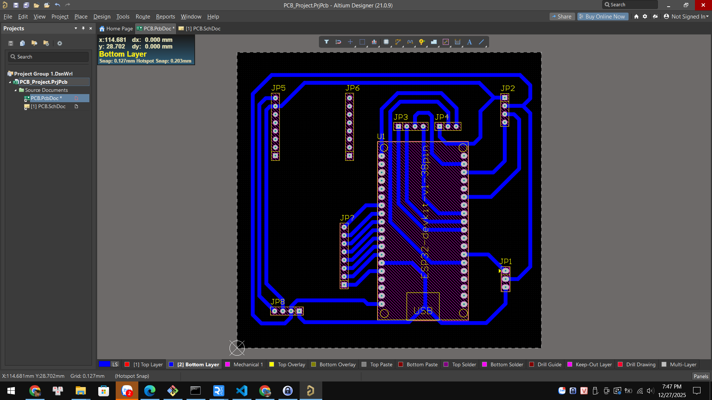
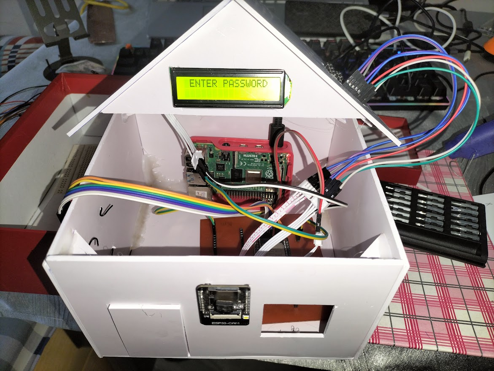
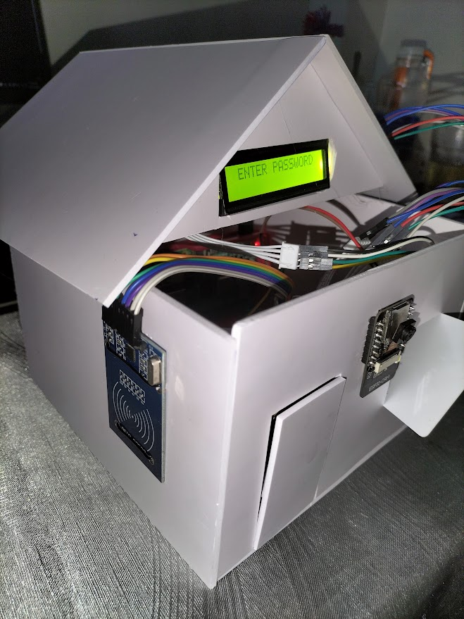
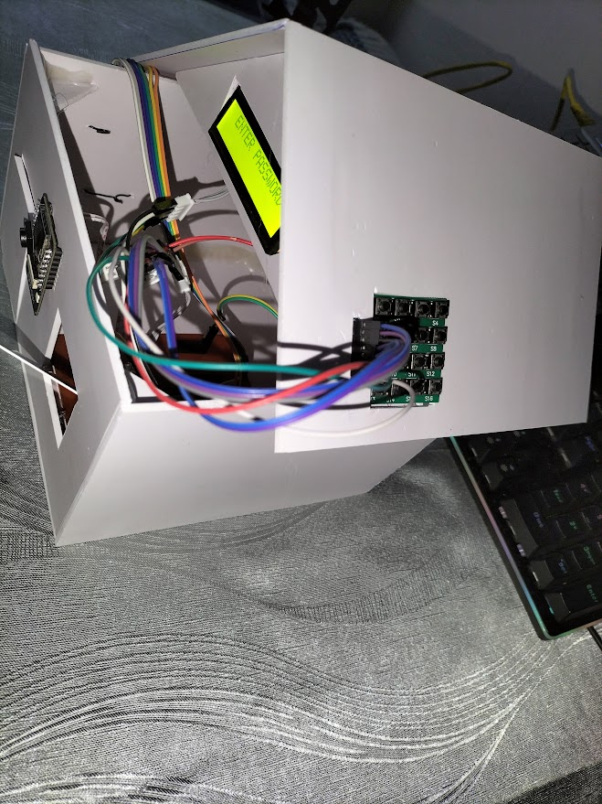
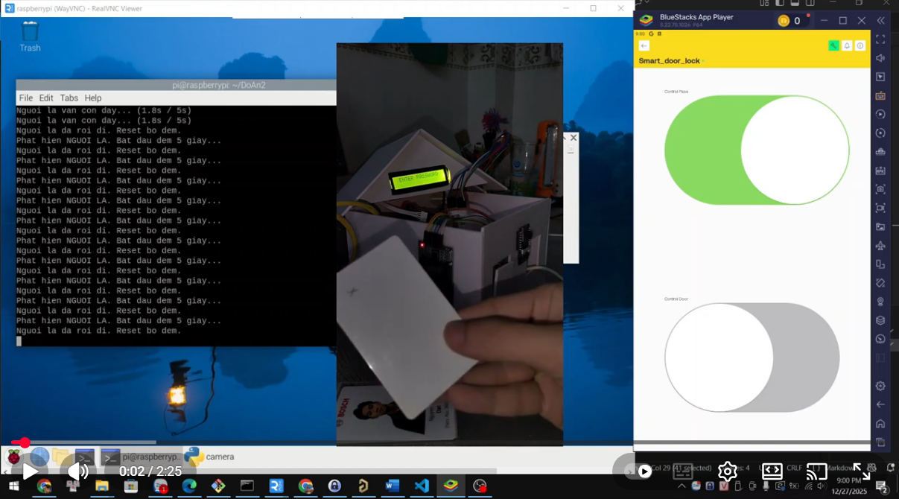

<div align="center">
  <h1>Smart Door Access Control System</h1>

  <p>
    <a href="#🚀-overview">Overview</a> •
    <a href="#🛠️-installation-and-usage-guide">Installation and Usage Guide</a> •
    <a href="#⚙️-blynk-configuration">Blynk Configuration</a> •
    <a href="#🚩-actual-product">Actual Product</a>
  </p>

  ---
</div>

<br>

## Overview

Welcome to the **`ESP32_Smart_door`** repository!

This project provides a complete solution for building a smart door system that allows you to control and monitor your door from anywhere using the Blynk mobile app. Using the powerful ESP32 microcontroller, this project combines hardware and software to bring convenience and security to your home.

<br>

## Installation and Usage Guide

To deploy this project, you need the following software and hardware components:

### Software Requirements:
* VS Code
* Arduino
* PlatformIO IDE Extension
* Blynk App (Android/iOS)

### Hardware Requirements:
* ESP32
* ESP Cam
* Raspberry Pi
* RC522 - RFID
* Servo SG90 (Door simulator)
* 4x4 Keypad Matrix
* Breadboard, jumper wires or PCB design and soldering

### Basic Steps:

* Install VS Code and PlatformIO IDE Extension
* Clone or download the project
    ```bash
    git clone https://github.com/your-username/ESP_RaspberryPi4_Door_lock_system.git
    ```
* Open the project in VS Code with PlatformIO
* Configure Blynk and WiFi information (see section below)
* Compile and upload the source code
* Set up the Blynk app
* Connect the hardware

<br>

## Blynk Configuration

To make the project work, you need to configure your Blynk account and project.

### 1. Create a New Project on Blynk Console
* Go to [Blynk Console](https://blynk.cloud/) and create an account (if you don't have one).
* Create a **New Template** for the "Smart Door" project.
* Save the **Template ID** and **Template Name**.
* When you create a new device from this template, you will receive an **Auth Token**.

### 2. Update the Information in Source Code
In the `src/main.cpp` file, you need to replace the following placeholders with your information:
* Enter your Blynk information in the blank spaces.
* Then enter your WiFi name and password.
```cpp
#define BLYNK_TEMPLATE_ID "YOUR_BLYNK_TEMPLATE_ID"
#define BLYNK_DEVICE_NAME "YOUR_BLYNK_TEMPLATE_NAME" // Your device name
#define BLYNK_AUTH_TOKEN "YOUR_BLYNK_AUTH_TOKEN"

char ssid[] = "YOUR_WIFI_SSID";     // Your WiFi network name
char pass[] = "YOUR_WIFI_PASSWORD"; // Your WiFi password
```

### 3. Set Up Datastreams in Blynk App
* Set up the virtual Control Pass switch to enable or disable password entry.
* Set up the virtual Control Door switch to open/close the door remotely.
* You need to create the corresponding Datastreams in the Blynk app to control and monitor the door.

**Control Door**: Used to control door opening/closing.  
**Control Pass**: Used to enable or disable password entry.



### 4. Set Up Events & Notifications in Blynk
* Set up to receive notifications when the door opens and when incorrect password is entered too many times.
  
**door_warning**: Receive notification when incorrect password is entered too many times.  
**infor_log**: Receive notification when the door opens and when a stranger stands in front of the door for too long. 


<br>

## Actual Product  

PCB




Product Images  

<div align="center">
  
  <br/><br/>
  
  <br/><br/>
  
</div>

Product Demo Video
[](assets/video/ESP-RaspberryPi4-Door-lock-system.mp4)


<br>
